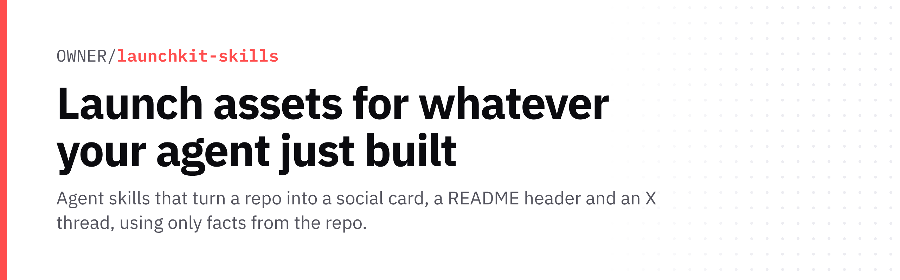

<p align="center">
  <picture>
    <source media="(prefers-color-scheme: dark)" srcset="./assets/hero-dark.png">
    
  </picture>
</p>

<p align="center"><b>Launch assets for whatever your agent just built.</b><br>Agent skills that turn a repo into a social card, a README header and an X thread, using only facts from the repo.</p>

## Skills

| Skill | What it makes | Example |
|---|---|---|
| [`og-image`](skills/og-image/SKILL.md) | A 1200x630 social / link-preview card (`og.png`) | [agent-browser](skills/og-image/examples/agent-browser/og.png) · [anthropics/skills](skills/og-image/examples/anthropics-skills/og.png) |
| [`readme-hero`](skills/readme-hero/SKILL.md) | Dark + light README banners and a paste-ready header (`HERO.md`) | [agent-browser](skills/readme-hero/examples/agent-browser/HERO.md) · [anthropics/skills](skills/readme-hero/examples/anthropics-skills/HERO.md) |
| [`x-launch-thread`](skills/x-launch-thread/SKILL.md) | A 3–5 post X thread plus a link reply, linted for length, spam patterns and invented numbers | [agent-browser](skills/x-launch-thread/examples/agent-browser/thread.md) · [anthropics/skills](skills/x-launch-thread/examples/anthropics-skills/thread.md) |

Every example was made by running the skill on a real public repo (`vercel-labs/agent-browser`, `anthropics/skills`). Facts were read from the GitHub API on Nov 10, 2026; star counts go stale.

## Install

Each skill is a folder with a `SKILL.md` ([Agent Skills format](https://agentskills.io)), so any agent that reads skills can use it.

**skills.sh (Claude Code, Codex, Cursor and others):**
```bash
npx skills add Agentlaunchkit/Launchkit-skills
```

**Claude Code plugin marketplace:**
```
/plugin marketplace add Agentlaunchkit/Launchkit-skills
/plugin install launchkit@launchkit-skills
```

**Manual:** copy `skills/<name>/` into your agent's skills folder (e.g. `~/.claude/skills/`, `.codex/skills/`, `.cursor/skills/`).

Then ask your agent: *"Make an OG image for vercel-labs/agent-browser"* or *"Draft a launch thread for this repo."*

## Requirements

- Python 3.8+ (standard library only)
- Chrome or Chromium on `PATH` for PNG rendering (or set `CHROME=/path/to/chrome`). Without it, the skills still write HTML you can screenshot.
- Network access to `api.github.com`. Set `GITHUB_TOKEN` to raise the rate limit (optional).

## Principles

- **Facts, not vibes.** Numbers come from the repo, with the date they were read. `x-launch-thread` flags any number it can't find in the facts.
- **Drafts only.** Nothing is posted, pushed or committed unless you ask.
- **No spam patterns.** No engagement bait, hashtag stacks or tag-farming.

## License

MIT. Example outputs describe third-party projects (Apache-2.0 `vercel-labs/agent-browser`, `anthropics/skills`) and contain no code from them; names and trademarks belong to their owners.
