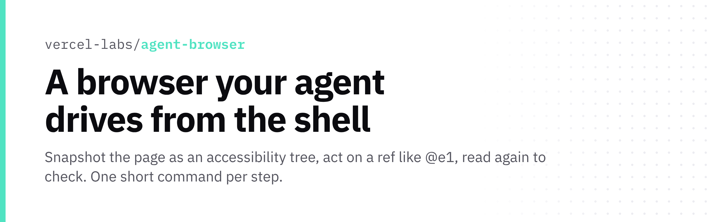

<p align="center">
  <picture>
    <source media="(prefers-color-scheme: dark)" srcset="./hero-dark.png">
    
  </picture>
</p>

<p align="center"><b>A browser your agent drives from the shell</b><br>Snapshot the page as an accessibility tree, act on a ref like @e1, read again to check. One short command per step.</p>

<p align="center">

[](https://github.com/vercel-labs/agent-browser/stargazers) [](https://github.com/vercel-labs/agent-browser/releases) [](https://www.npmjs.com/package/agent-browser) [](https://github.com/vercel-labs/agent-browser/blob/HEAD/LICENSE)

</p>

## Quick start

```bash
npm install -g agent-browser
agent-browser install
agent-browser open example.com
agent-browser snapshot -i
```

## Why

- Native Rust CLI with binaries for macOS, Linux (glibc + musl) and Windows
- Clicks fail loudly when the target is hidden, disabled or covered
- Ships version-matched skills (agent-browser skills get core) plus an MCP server

[Docs](https://agent-browser.dev)
