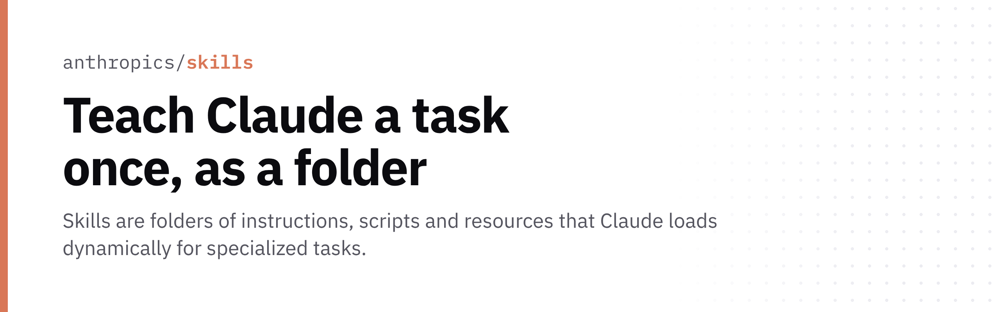

<p align="center">
  <picture>
    <source media="(prefers-color-scheme: dark)" srcset="./hero-dark.png">
    
  </picture>
</p>

<p align="center"><b>Teach Claude a task once, as a folder</b><br>Skills are folders of instructions, scripts and resources that Claude loads dynamically for specialized tasks.</p>

<p align="center">

[](https://github.com/anthropics/skills/stargazers)

</p>

## Quick start

```bash
/plugin marketplace add anthropics/skills
/plugin install document-skills@anthropic-agent-skills
```

## Why

- Each skill is self-contained: one folder with a SKILL.md (name + description frontmatter)
- Includes the docx, pdf, pptx and xlsx skills behind Claude's document features
- Works in Claude Code (plugin marketplace), Claude.ai paid plans and the Claude API

[Docs](https://agentskills.io)
